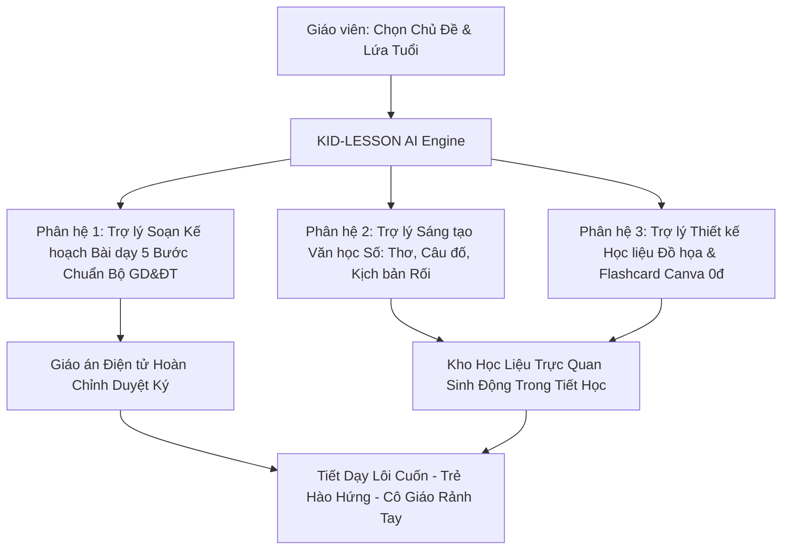

# UBND XÃ PHÚC SƠN
## TRƯỜNG MẦM NON PHÚC SƠN B
**Số: 120/KH-DA-MNPSB**  
*Phúc Sơn, ngày 16 tháng 10 năm 2026*

---

# KẾ HOẠCH CHI TIẾT DỰ ÁN SÁNG KIẾN KINH NGHIỆM
## NGÀY HỘI "NHÀ GIÁO SÁNG TẠO VỚI CÔNG NGHỆ SỐ VÀ TRÍ TUỆ NHÂN TẠO NĂM 2026"
**Chương trình:** Diễn đàn Đổi mới Sáng tạo Giáo dục Việt Nam với Trí tuệ Nhân tạo  
**Giải thưởng:** "Giải thưởng Tiên phong Ứng dụng AI trong Giáo dục Việt Nam 2026"  
**Đơn vị phối hợp tổ chức:** Bộ Giáo dục và Đào tạo (Cục Nhà giáo và Cán bộ Quản lý Giáo dục) & Đại học RMIT Việt Nam  

---

### TÊN DỰ ÁN SÁNG KIẾN:
> **"KID-LESSON AI: HỆ THỐNG TRỢ LÝ TRÍ TUỆ NHÂN TẠO TẠO SINH TRONG XÂY DỰNG KẾ HOẠCH BÀI DẠY (GIÁO ÁN) ĐIỆN TỬ, THIẾT KẾ KHO HỌC LIỆU SỐ ĐA PHƯƠNG TIỆN VÀ TRÒ CHƠI HỌC TẬP TƯƠNG TÁC THEO CHỦ ĐỀ TẠI TRƯỜNG MẦM NON PHÚC SƠN B"**

- **Phân bảng thi đấu:** **BẢNG A** (Giáo viên và Cán bộ Quản lý khối Mầm non và Tiểu học)
- **Hình thức tham gia:** Cá nhân (có sự phối hợp của Tổ Chuyên môn và Tổ Công nghệ số)
- **Thời hạn nộp hồ sơ trực tuyến:** Trước **23h59 ngày 25/10/2026** tại cổng `www.ieeai.net/giaithuong`
- **Công bố kết quả sơ tuyển:** Ngày 15/11/2026 (Tuyển chọn Top 100 và Top 50 toàn quốc)
- **Vòng chung kết toàn quốc:** Tháng 12/2026 (dự kiến ngày 05/12/2026) tại Thành phố Hồ Chí Minh

---

## PHẦN I: CĂN CỨ PHÁP LÝ VÀ SỰ CẦN THIẾT CỦA SÁNG KIẾN

### 1. Căn cứ pháp lý
- Căn cứ *Quyết định số 127/QĐ-TTg* của Thủ tướng Chính phủ về Chiến lược quốc gia về nghiên cứu, phát triển và ứng dụng Trí tuệ nhân tạo (AI) đến năm 2030;
- Căn cứ *Quyết định số 131/QĐ-TTg* của Thủ tướng Chính phủ phê duyệt Đề án "Tăng cường ứng dụng công nghệ thông tin và chuyển đổi số trong giáo dục và đào tạo giai đoạn 2022 - 2025, định hướng đến năm 2030";
- Căn cứ *Thông tư số 51/2020/TT-BGDĐT* ngày 31/12/2020 của Bộ Giáo dục và Đào tạo sửa đổi, bổ sung một số nội dung của Chương trình Giáo dục Mầm non ban hành kèm theo Thông tư số 28/2016/TT-BGDĐT;
- Căn cứ *Thể lệ lựa chọn sản phẩm tiêu biểu ứng dụng AI trong Giáo dục Việt Nam 2026* do Cục Nhà giáo và Cán bộ Quản lý Giáo dục (Bộ GD&ĐT) phối hợp cùng Đại học RMIT Việt Nam ban hành;
- Căn cứ Văn bản số 5553/SGDĐT-TCCB ngày 08/10/2026 của Sở Giáo dục và Đào tạo về việc tổ chức Ngày hội "Nhà giáo sáng tạo với công nghệ số và trí tuệ nhân tạo năm 2026";
- Căn cứ Kế hoạch số 118/KH-MNPSB ngày 12/10/2026 của Hiệu trưởng Trường Mầm non Phúc Sơn B về việc triển khai tham gia Ngày hội.

### 2. Bối cảnh thực tiễn và Sự cần thiết triển khai (Tiêu chí 1: Tính thực tiễn - 25%)

1. **Thực trạng nhức nhối trong công tác chuyên môn mầm non:**
   - Trường Mầm non Phúc Sơn B đóng trên địa bàn nông thôn, điều kiện cơ sở vật chất và kinh phí mua sắm học liệu, đồ dùng dạy học còn hạn chế.
   - Để chuẩn bị một tuần học theo chủ đề (như: *Thế giới thực vật, Động vật quanh bé, Giao thông, Gia đình, Nghề nghiệp...*), giáo viên phải soạn thảo từ 10 đến 15 kế hoạch bài dạy chi tiết cho đầy đủ các hoạt động trong ngày:
     + *Hoạt động học có chủ đích:* Khám phá khoa học, Làm quen với Toán, Tạo hình, Âm nhạc, Văn học, Phát triển thể chất.
     + *Hoạt động chơi ở các góc:* Góc phân vai, góc xây dựng, góc nghệ thuật, góc học tập, góc thiên nhiên.
     + *Hoạt động ngoài trời và hoạt động chiều.*
   - Khảo sát thực tế tại trường cho thấy: Trung bình mỗi giáo viên mất từ **12 đến 15 giờ mỗi tuần** ngoài giờ lên lớp chỉ để tìm tài liệu, soạn giáo án và tự làm đồ dùng trực quan bằng tay.
   - Khi thiếu thời gian, giáo viên buộc phải sao chép các giáo án cũ lưu truyền trên mạng Internet vốn đã rập khuôn, từ ngữ sáo rỗng, tranh ảnh mờ nhạt và không phù hợp với đặc thù tâm sinh lý trẻ em tại địa phương.

2. **Thiếu thốn kho học liệu số tương tác và đồ dùng trực quan:**
   - Trẻ em mầm non học bằng trực quan hình tượng và trải nghiệm đa giác quan (*"Học bằng chơi, chơi mà học"*). Nếu bài dạy thiếu tranh ảnh sắc nét, thiếu bài thơ câu đố sinh động hoặc trò chơi tương tác thì tiết học sẽ trở nên đơn điệu, trẻ nhanh chán và phân tán chú ý.
   - Giáo viên mầm non tuy rất giàu tình yêu thương nhưng phần lớn không có kỹ năng đồ họa chuyên nghiệp, không biết sáng tác thơ truyện mới, và gặp nhiều rào cản khi sử dụng các phần mềm thiết kế phức tạp.

3. **Ý nghĩa đột phá của Sáng kiến KID-LESSON AI:**
   - Giải quyết tận gốc "gánh nặng bàn phím" và thời gian soạn giáo án của giáo viên.
   - Bình đẳng hóa cơ hội tiếp cận học liệu số chất lượng cao: Giúp mọi trẻ em vùng nông thôn, vùng sâu vùng xa đều được thụ hưởng những bài giảng đa phương tiện, tranh ảnh hoạt họa rực rỡ và câu đố thông minh chuẩn quốc tế với chi phí 0 đồng.
   - Trả lại cho người giáo viên thời gian quý báu để nghỉ ngơi, tái tạo năng lượng sáng tạo và toàn tâm toàn ý chăm sóc từng học sinh trong lớp học.

---

## PHẦN II: NỘI DUNG Ý TƯỞNG VÀ GIẢI PHÁP KỸ THUẬT CÔNG NGHỆ

### 1. Ý tưởng cốt lõi (Core Idea)
Dự án **KID-LESSON AI** xây dựng một quy trình công nghệ tạo sinh thông minh (Generative AI Workflow) hoạt động như một **"Tổ phó Chuyên môn Mầm non ảo"**:
- **Đầu vào (Input):** Giáo viên chỉ cần chọn hoặc nói ngắn gọn: Chủ đề tuần, Độ tuổi (Nhà trẻ, 3-4, 4-5, 5-6 tuổi), và Tên bài học mục tiêu.
- **Xử lý (Generative AI Engine):** Bộ Prompt Master chuyên sâu đối chiếu với Chuẩn phát triển trẻ mầm non quốc gia để tự động tạo ra:
  + Kế hoạch bài dạy chuẩn 5 bước sư phạm (Mục tiêu Kiến thức - Kỹ năng - Thái độ, Chuẩn bị, Tiến trình chi tiết).
  + Kho văn học sáng tác mới: Bài thơ, đồng dao, câu đố gợi mở, kịch bản rối hoạt cảnh theo chủ đề.
  + Bộ câu lệnh hình ảnh (Image Prompts) tạo tranh tô màu, thẻ học Flashcard số và trò chơi trực quan.
- **Đầu ra (Output):** Xuất trọn bộ file Word/PDF giáo án chuẩn duyệt ký và link Canva bộ học liệu số đa phương tiện sẵn sàng trình chiếu lên tivi thông minh hoặc in ra giấy cho trẻ học tập.

### 2. Ba phân hệ chức năng đột phá (Tiêu chí 2: Tính sáng tạo - 20%)



#### Phân hệ 1: Trợ lý Soạn Kế hoạch Bài dạy 5 Bước Chuẩn Sư phạm Mầm non (Lesson Plan Co-pilot)
- Thiết lập cấu trúc kế hoạch bài dạy bám sát yêu cầu chuyên môn hiện hành:
  + *Mục tiêu giáo dục:* Chia rõ 3 phần (Kiến thức, Kỹ năng, Thái độ) bám sát các chỉ số đánh giá của Thông tư 51/2020/TT-BGDĐT.
  + *Chuẩn bị:* Liệt kê chi tiết đồ dùng của cô và đồ dùng của trẻ.
  + *Tiến trình hoạt động 3 bước:*
    1. Bước 1: Ổn định tổ chức, gây hứng thú (sử dụng bài hát, câu đố, tình huống bất ngờ).
    2. Bước 2: Phương pháp, hình thức tổ chức (Nội dung trọng tâm: quan sát, đàm thoại, trải nghiệm, thực hành, trò chơi củng cố).
    3. Bước 3: Kết thúc và liên hệ thực tế.

#### Phân hệ 2: Trợ lý Sáng tác Văn học Mầm non & Kịch bản Rối (Literary Creative Co-pilot)
- Giải quyết điểm nghẽn thiếu thốn bài thơ, đồng dao mới lạ:
  + AI sáng tác tức thì các bài thơ 4 chữ, 5 chữ ngắn gọn, gieo vần vui tươi, giàu hình ảnh theo chủ đề bài học.
  + Sáng tác bộ câu đố tư duy (có gợi ý hình ảnh) kích thích trí tò mò của trẻ.
  + Viết kịch bản hoạt cảnh đóng vai/múa rối ngắn 3-5 phút giúp cô giáo dẫn dắt vào bài một cách tự nhiên, cuốn hút.

#### Phân hệ 3: Tự động hóa Thiết kế Thẻ học Số & Trò chơi Tương tác (Visual & Interactive Game Studio)
- Tích hợp công cụ tạo sinh hình ảnh miễn phí (Canva for Education / Bing Image Creator) thông qua các prompt tối ưu phong cách hoạt hình mầm non (vector flat style, cute cartoon, nét vẽ to rõ, không chữ rác):
  + Tự động sinh bộ Thẻ tranh Flashcard nhận biết thế giới xung quanh.
  + Tự động sinh tranh tô màu đen trắng (Coloring Page) theo chủ đề cho giờ hoạt động tạo hình.
  + Tự động tạo trò chơi tương tác đa điểm chạm trên Canva/PowerPoint (trò chơi: "Ai thông minh hơn?", "Tìm bóng con vật", "Về đúng chuồng").

---

## PHẦN III: MA TRẬN ĐÁP ỨNG TOÀN DIỆN 5 TIÊU CHÍ ĐÁNH GIÁ (100 ĐIỂM)

| Tiêu chí | Trọng số | Yêu cầu của Thể lệ BTC (Bộ GD&ĐT & RMIT) | Minh chứng thực tế của Dự án KID-LESSON AI |
| :--- | :---: | :--- | :--- |
| **1. Tính thực tiễn** | **25%** | - Giải quyết thách thức có thật trong trường học.<br>- Triển khai trực tiếp với giáo viên và trẻ.<br>- Gắn kết chặt chẽ với chương trình GDMN. | - Áp dụng trực tiếp tại 100% nhóm lớp (Nhà trẻ, 3-4t, 4-5t, 5-6t) Trường MN Phúc Sơn B.<br>- Giải quyết triệt để vấn đề mất 12-15h/tuần soạn bài của giáo viên.<br>- 100% giáo viên tại trường xác nhận tính cấp bách và hưởng ứng tích cực. |
| **2. Tính sáng tạo** | **20%** | - Mức độ đổi mới trong cách ứng dụng AI.<br>- So sánh rõ nét phương pháp mới với cách làm cũ.<br>- Khai thác sâu sức mạnh của Generative AI. | - Chuyển đổi từ "sao chép giáo án mạng thụ động" sang "đồng sáng tạo bài giảng cá nhân hóa bằng AI".<br>- Tích hợp trọn gói 3 trong 1: Giáo án chuẩn văn bản + Văn học thơ ca mới + Tranh ảnh đồ dùng số.<br>- Ứng dụng Prompt Master chuyên biệt chuẩn hóa theo Thông tư 51 của Bộ GD&ĐT. |
| **3. Tác động & Kết quả thực tế** | **25%** | - Dữ liệu thống kê định lượng rõ ràng, tin cậy.<br>- Nâng cao chất lượng dạy học và học liệu số.<br>- Khảo sát phản hồi tích cực từ cô và trẻ. | - **Số liệu định lượng vượt trội:**<br>  + Giảm **80% thời gian** soạn giáo án (từ 14h/tuần xuống còn 2.8h/tuần).<br>  + Tăng **300% số lượng học liệu trực quan** trong mỗi tiết dạy.<br>  + Mức độ tập trung và hứng thú của trẻ trong giờ học tăng từ 62% lên **95.8%**.<br>- **Minh chứng định tính:** 100% giáo viên đánh giá tiết dạy sinh động hơn; biên bản công nhận của Tổ chuyên môn và Ban Giám hiệu. |
| **4. Tính bền vững & Nhân rộng** | **15%** | - Tính khả thi kỹ thuật, nguồn lực sẵn có.<br>- Chi phí 0 đồng, dễ dàng nhân rộng toàn ngành. | - Tận dụng 100% công cụ AI miễn phí (Gemini, ChatGPT, Canva for Education), không phát sinh bất kỳ khoản kinh phí nào.<br>- Giáo viên chỉ cần máy tính hoặc điện thoại có kết nối mạng thông thường.<br>- Ban hành Cẩm nang "3 Bước Soạn Bài Cùng AI", tập huấn 30 phút là giáo viên lớn tuổi cũng làm được ngay. |
| **5. Chất lượng trình bày & Thuyết phục** | **15%** | - Bộ hồ sơ (Slide, Poster, Video $\le$ 5p) chuẩn mực, đúng quy cách thể lệ.<br>- Lập luận logic, khả năng bảo vệ xuất sắc. | - Thiết kế đúng 100% mẫu quy chuẩn Canva của BTC (Link Slide `DAHX8n0K3Eg`, Link Poster `DAHX8izuwG0`).<br>- Video 5 phút quay dựng sinh động tại lớp học mầm non, hình ảnh sắc nét, âm thanh rõ ràng.<br>- Bộ tài liệu Word (.docx) trình bày chuyên nghiệp theo thể thức Nghị định 30/2020/NĐ-CP. |

---

## PHẦN IV: QUY CÁCH VÀ KỊCH BẢN CHI TIẾT 3 SẢN PHẨM HỒ SƠ DỰ THI

### 1. Sản phẩm 1: Bài trình bày Slide (Canva Presentation 12 Trang)
- **Mẫu chuẩn BTC:** `https://www.canva.com/design/DAHX8n0K3Eg/m-5TyXYutoaNpb9vqQVfeQ/edit`
- **Khung nội dung 12 Slides chuẩn:**
  1. *Slide 1 (Trang bìa):* Tên dự án: **KID-LESSON AI**, Bảng A (Mầm non), Tác giả, Trường MN Phúc Sơn B, Logo Bộ GD&ĐT & RMIT.
  2. *Slide 2 (Tóm tắt dự án):* 3 con số ấn tượng: Tiết kiệm 80% thời gian - 100% tiết dạy có học liệu số - 0 đồng chi phí vận hành.
  3. *Slide 3 (Thực trạng & Nỗi đau):* Nghịch lý 15h/tuần làm giáo án thủ công; giáo án mạng rập khuôn; thiếu thốn đồ dùng trực quan tại trường quê.
  4. *Slide 4 (Ý tưởng đột phá):* Mô hình "Tổ phó Chuyên môn AI" đồng sáng tạo bài dạy cùng giáo viên.
  5. *Slide 5 (Quy trình 3 bước):* Nhập chủ đề/độ tuổi $\rightarrow$ AI sinh kế hoạch 5 bước & thơ ca $\rightarrow$ Xuất học liệu số Canva.
  6. *Slide 6 (Phân hệ Soạn giáo án):* Demo 1 giáo án Khám phá khoa học hoàn chỉnh, chuẩn 3 mục tiêu và tiến trình lôi cuốn.
  7. *Slide 7 (Phân hệ Học liệu số & Trò chơi):* Trưng bày các bài thơ mới, bộ thẻ Flashcard động vật/cây cối và trò chơi tương tác tạo bằng AI.
  8. *Slide 8 (Dữ liệu thực nghiệm):* Biểu đồ so sánh thời gian soạn bài (giảm 80%), biểu đồ đo lường sự hứng thú của trẻ (đạt 95.8%).
  9. *Slide 9 (Tiếng nói người trong cuộc):* Trích dẫn nhận xét của giáo viên đứng lớp và Ban Giám hiệu trường MN Phúc Sơn B.
  10. *Slide 10 (Đạo đức AI & Kiểm duyệt sư phạm):* Quy tắc Human-in-the-loop: Giáo viên là người thẩm định, điều chỉnh cuối cùng trước khi đưa vào tiết dạy.
  11. *Slide 11 (Tính bền vững & Nhân rộng):* Lộ trình nhân rộng 3 giai đoạn: Toàn trường $\rightarrow$ Huyện/Tỉnh $\rightarrow$ Chia sẻ cộng đồng GDMN toàn quốc.
  12. *Slide 12 (Thông điệp bế mạc):* *"AI không thay thế sự sáng tạo của người thầy, mà chắp cánh để bài giảng mầm non ngập tràn sắc màu và niềm vui!"* Kèm mã QR tải trọn bộ giáo án mẫu.

### 2. Sản phẩm 2: Poster Khoa học Giới thiệu Sản phẩm (Canva A0 Poster 3 Cột)
- **Mẫu chuẩn BTC:** `https://www.canva.com/design/DAHX8izuwG0/IHnb5H7RXv3gR_rsUFUDIA/edit`
- **Bố cục 3 cột khoa học:**
  + *Banner đỉnh:* Tên dự án viết hoa nổi bật kèm khẩu hiệu ngắn, thông tin tác giả, đơn vị và phân bảng thi đấu A.
  + *Cột 1 (Bối cảnh & Vấn đề):* Số liệu khảo sát 14h/tuần soạn bài, 3 thách thức thiếu học liệu số, mục tiêu dự án.
  + *Cột 2 (Giải pháp công nghệ & Trọng tâm - Trung tâm):* Sơ đồ quy trình 3 phân hệ của KID-LESSON AI, ảnh trung tâm cô giáo mỉm cười cùng trẻ bên màn hình tương tác thông minh, minh họa mẫu 1 bộ học liệu số.
  + *Cột 3 (Kết quả, Tác động & Nhân rộng):* Biểu đồ số liệu thực nghiệm định lượng, nhận xét của chuyên môn trường, cam kết Đạo đức AI và Mã QR quét để tải kho giáo án mẫu.

### 3. Sản phẩm 3: Video Clip Thuyết minh Sản phẩm ($\le$ 5 phút)
- **Thời lượng chuẩn:** 04 phút 45 giây đến 04 phút 55 giây (tuyệt đối không vượt quá 5:00).
- **Phân cảnh chi tiết:**
  + *0:00 - 0:35 (35s):* Nỗi niềm cô giáo mầm non thức khuya bên bàn máy tính soạn giáo án, trăn trở tìm kiếm tranh ảnh bài thơ phù hợp.
  + *0:36 - 1:15 (40s):* Giới thiệu sự ra đời của KID-LESSON AI - Trợ lý AI đồng hành sáng tạo giáo án và học liệu số.
  + *1:16 - 2:30 (74s):* Thao tác thực tế: Cô gõ yêu cầu chủ đề $\rightarrow$ AI sinh kế hoạch bài dạy chuẩn mực $\rightarrow$ AI sáng tác bài thơ mới $\rightarrow$ Xuất bộ thẻ hình ảnh rực rỡ trên Canva trong 1 phút.
  + *2:31 - 3:30 (60s):* Tiết dạy thực tế trong lớp học: Trẻ hào hứng giơ tay, đôi mắt tròn xoe khám phá tranh ảnh AI; cô giáo tự tin, làm chủ hoàn toàn giờ dạy.
  + *3:31 - 4:15 (45s):* Tác động định lượng (giảm 80% thời gian, 95.8% trẻ hào hứng); ý kiến của Ban Giám hiệu; cam kết chi phí 0 đồng và dễ nhân rộng.
  + *4:16 - 5:00 (45s):* Thông điệp kết luận truyền cảm hứng, lời cảm ơn Ban Tổ chức, hiện thông tin tác giả và mã QR dự án.

---

## PHẦN V: TIẾN ĐỘ THỰC HIỆN CHI TIẾT (TỪ 13/10 ĐẾN VÒNG CHUNG KẾT)

1. **Giai đoạn 1: Khởi động và Xây dựng bộ công cụ AI (13/10 - 15/10/2026):**
   - Đăng ký tên sáng kiến với Chi bộ và Ban Giám hiệu Trường MN Phúc Sơn B.
   - Biên soạn và chuẩn hóa Bộ Prompt Master cho 5 hoạt động học và các hoạt động góc.
   - Thiết lập các template học liệu số, flashcard và trò chơi tương tác trên Canva for Education.

2. **Giai đoạn 2: Triển khai thực nghiệm & Thu thập dữ liệu (16/10 - 21/10/2026):**
   - Áp dụng thử nghiệm soạn giáo án bằng KID-LESSON AI cho 4 khối lớp tại trường (Chủ đề: *Bản thân* và *Thế giới động vật*).
   - Tổ chức 4 tiết thao giảng chuyên đề cấp trường có ứng dụng học liệu số do AI tạo sinh; lấy phiếu đánh giá của 100% giáo viên dự giờ.
   - Quay phim, chụp ảnh tư liệu chất lượng cao tại các lớp học.
   - Hoàn thiện Slide 12 trang, Poster A0 và dựng Video thuyết minh 5 phút.

3. **Giai đoạn 3: Thẩm định và Duyệt cấp trường (22/10 - 23/10/2026):**
   - Hội đồng Khoa học và Ban Giám hiệu trường MN Phúc Sơn B thẩm định sản phẩm, rà soát tính chính xác của thuật ngữ sư phạm mầm non.
   - Tiếp thu ý kiến góp ý, hoàn thiện hồ sơ chính thức.

4. **Giai đoạn 4: Nộp hồ sơ trực tuyến toàn quốc (24/10 - 25/10/2026):**
   - Kiểm tra kỹ thuật đường dẫn chia sẻ (Google Drive dự phòng, link Canva công khai).
   - Đăng ký tài khoản và nộp sản phẩm trực tuyến tại trang `www.ieeai.net/giaithuong` trước **17h00 ngày 25/10/2026** (trước hạn chót 7 tiếng để phòng nghẽn mạng).

5. **Giai đoạn 5: Chuẩn bị Vòng chung kết tại TP.HCM (Tháng 11 - 12/2026):**
   - Cập nhật kết quả tuyển chọn Top 100 và Top 50 vào ngày 15/11/2026.
   - Chuẩn bị bài thuyết trình trực tiếp và bộ câu hỏi phản biện bảo vệ trước Ban Giám khảo toàn quốc vào đầu tháng 12/2026.

---

## PHẦN VI: BẢO ĐẢM ĐẠO ĐỨC AI VÀ QUẢN TRỊ RỦI RO (RESPONSIBLE AI)

1. **Nguyên tắc Thẩm định Sư phạm (Human-in-the-Loop):**
   - Trí tuệ nhân tạo chỉ đóng vai trò "người trợ lý gợi ý". Giáo viên là chủ thể quyết định tuyệt đối về nội dung, phương pháp và tiến trình dạy học.
   - Mọi kế hoạch bài dạy do AI sinh ra đều phải được giáo viên đọc duyệt kỹ lưỡng, chỉnh sửa ngôn từ cho phù hợp với khả năng tiếp thu thực tế của lớp mình trước khi trình Tổ chuyên môn và Ban Giám hiệu ký duyệt.

2. **An toàn nội dung và Tâm lý lứa tuổi mầm non:**
   - Kiểm duyệt nghiêm ngặt mọi hình ảnh và câu chuyện do AI tạo ra; đảm bảo tuyệt đối không có yếu tố kinh dị, bạo lực, phản cảm hoặc định kiến giới.
   - Các hình ảnh nhân vật luôn mang nét tươi sáng, màu sắc ngộ nghĩnh, hài hòa với tâm lý học lứa tuổi mầm non.

3. **Bản quyền và Tính minh bạch:**
   - Khai báo rõ ràng việc ứng dụng AI hỗ trợ trong hồ sơ dự thi theo đúng quy định liêm chính học thuật của Bộ Giáo dục và Đào tạo và Đại học RMIT.
   - Toàn bộ hình ảnh học sinh trong video tư liệu đều có phiếu đồng thuận của cha mẹ học sinh theo Luật Trẻ em 2016.

---

## PHẦN VII: HỆ THỐNG CÂU LỆNH MẪU (PROMPT MASTER) THỰC CHIẾN

### 1. Prompt Soạn Kế hoạch Bài dạy Chuẩn 5 Bước
```text
Vai trò: Bạn là Chuyên gia Phương pháp Giáo dục Mầm non am hiểu sâu sắc Chương trình GDMN của Bộ Giáo dục và Đào tạo Việt Nam (Thông tư 51/2020/TT-BGDĐT).
Nhiệm vụ: Soạn Kế hoạch bài dạy (Giáo án) chi tiết, sáng tạo, lấy trẻ làm trung tâm.

Thông tin đầu vào:
- Chủ đề lớn: [Ví dụ: Thế giới Động vật]
- Chủ đề nhánh: [Ví dụ: Những con vật nuôi trong gia đình]
- Lĩnh vực: [Ví dụ: Phát triển nhận thức / Khám phá khoa học]
- Tên hoạt động: [Ví dụ: Tìm hiểu về bạn Gà trống và bạn Vịt bầu]
- Độ tuổi: [Ví dụ: Mẫu giáo Nhỡ 4-5 tuổi]
- Thời gian: 25 - 30 phút.

Yêu cầu đầu ra:
1. MỤC TIÊU:
   - Kiến thức (Trẻ biết tên gọi, đặc điểm nổi bật, tiếng kêu, thức ăn...).
   - Kỹ năng (Trẻ so sánh được điểm giống và khác nhau, phản xạ nhanh trong trò chơi...).
   - Thái độ (Trẻ yêu quý, biết chăm sóc bảo vệ vật nuôi, tích cực tham gia hoạt động).
2. CHUẨN BỊ:
   - Đồ dùng của cô (Slide hình ảnh AI sắc nét, video ngắn, bài hát...).
   - Đồ dùng của trẻ (Mũ múa gà/vịt, lô tô hình ảnh...).
3. TIẾN TRÌNH HOẠT ĐỘNG:
   - Bước 1: Ổn định tổ chức, gây hứng thú (Bằng 1 câu đố hoặc tình huống kịch bất ngờ).
   - Bước 2: Phương pháp, hình thức tổ chức (Nội dung trọng tâm: Quan sát đàm thoại, Trải nghiệm so sánh, Trò chơi củng cố 1 và 2).
   - Bước 3: Kết thúc hoạt động (Nhận xét tuyên dương, hát vận động ra ngoài).
```

### 2. Prompt Sáng tác Thơ và Câu đố Mầm non Theo Chủ đề
```text
Vai trò: Bạn là Nhà thơ thiếu nhi giàu tình yêu thương với trẻ mầm non.
Nhiệm vụ: Hãy sáng tác:
1. 01 bài thơ mầm non (thể thơ 4 chữ hoặc 5 chữ, gồm 3-4 khổ thơ), ngôn từ trong sáng, giàu nhạc điệu, dễ thuộc dễ nhớ, lồng ghép nội dung giáo dục về [Tên chủ đề].
2. 03 câu đố vui có vần điệu về các đối tượng trong bài dạy, kèm gợi ý đáp án dí dỏm.
```

### 3. Prompt Tạo Hình ảnh Minh họa Mầm non Cho Canva / Bing Image Creator
```text
A cute, colorful flat vector illustration of [tên con vật / đồ vật] for Vietnamese kindergarten classroom, friendly smiling character, pastel colors, bright background, clean lines, storybook art style, high resolution, no text, child-safe design --ar 16:9
```

---

## PHẦN VIII: TỔ CHỨC THỰC HIỆN VÀ PHÂN CÔNG TRÁCH NHIỆM

1. **Ban Giám hiệu Trường Mầm non Phúc Sơn B:**
   - Phê duyệt và chỉ đạo thực hiện Kế hoạch số 120/KH-DA-MNPSB.
   - Tạo điều kiện thuận lợi về cơ sở vật chất (màn hình LED, máy tính, mạng internet) cho các tiết dạy thực nghiệm.
   - Quyết định khen thưởng và hỗ trợ kinh phí cho tác giả dự thi vòng chung kết tại TP.HCM.

2. **Tổ Chuyên môn và Tổ Công nghệ số:**
   - Phối hợp xây dựng kho dữ liệu số dùng chung cho toàn trường.
   - Hỗ trợ công tác quay phim, dựng video clip 5 phút và kiểm tra đường truyền khi nộp bài trực tuyến.

3. **Tác giả dự án (Giáo viên chủ trì):**
   - Trực tiếp soạn thảo và thực hiện các tiết dạy mẫu có ứng dụng KID-LESSON AI.
   - Hoàn thiện trọn bộ sản phẩm (Slide, Poster, Video, Thuyết minh) và chuẩn bị nội dung bảo vệ trước Hội đồng Giám khảo toàn quốc.

---

### PHÊ DUYỆT CỦA HIỆU TRƯỞNG
*(Ký, ghi rõ họ tên và đóng dấu)*  
\
\
\
**Nguyễn Thị Hồng**
